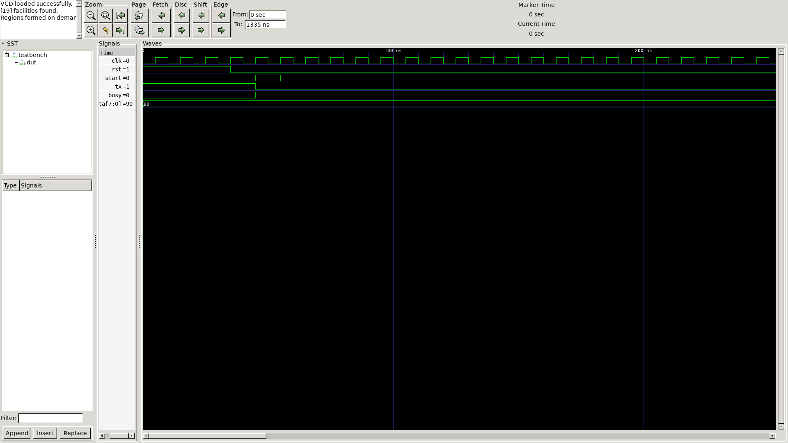
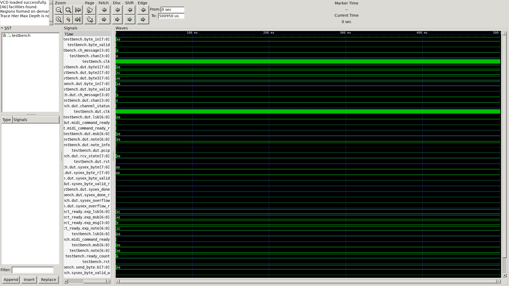

# I/O modules

Граница ПЛИС с внешним миром

| N | Module | Description | Img |
| - | ------ | --- | --- |
| 1 | uart_tx | UART TX 8N1; по умолчанию MIDI 31250 бод (CLK_HZ/BAUD) |  |
| 2 | midi_in | MIDI byte parser: channel voice → ch_message/lsb/msb; SysEx skip (v1); UART — на плате |  |

<!-- generated by tools/gen_readme.py -->
